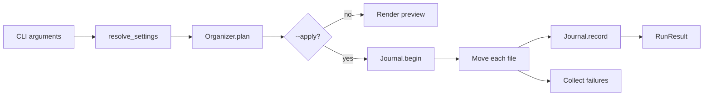

# Architecture

This document describes how the tool is put together and, more importantly,
which invariants keep it safe when it runs against a real folder.

## Goals

1. **Never surprise the user.** The default mode is a preview, and the preview
   is produced by the same planner that performs the real run.
2. **Be reversible.** Every move is journaled, and a run can be undone in full
   or previewed first.
3. **Fail softly.** One locked file must not abort a run or leave the folder in
   an inconsistent state.
4. **Have no runtime dependencies.** The tool runs on a bare Python 3.11+
   installation, which makes it easy to audit and easy to install.

## Non-goals

- Watching folders in the background (there is no daemon or scheduler).
- Deduplicating files across the whole disk.
- Recovering files deleted by the `overwrite` policy.

## Module map

| Module | Responsibility |
| --- | --- |
| `categories.py` | Immutable `RuleSet`, extension normalisation, category-name validation. |
| `config.py` | TOML loading, precedence (CLI > file > default), `Settings`, `ConflictPolicy`. |
| `organizer.py` | Scanning, planning, conflict resolution, execution, undo. |
| `journal.py` | Append-only JSON Lines journal and run metadata. |
| `cli.py` | Argument parsing, human and JSON rendering, exit codes. |
| `console.py` | Minimal ANSI/table helpers with no third-party dependency. |
| `utils.py` | Platform paths, hashing, partial-download detection, size formatting. |
| `errors.py` | `OrganizerError` hierarchy used for CLI error mapping. |

Dependencies point inwards: `cli` → `organizer` → `config`/`journal` →
`categories`/`utils`/`errors`. There are no cycles.

## Data flow



Planning and execution are separate on purpose:

- `plan()` only reads the filesystem and returns an immutable `Plan`
  (`moves` + `skipped`). It never creates a folder.
- `execute(plan)` creates the category folders lazily and journals each
  successful move.
- `undo_run()` reads the journal, verifies both ends of every recorded move,
  and replays the moves in reverse order.

## Invariants

These hold at every point of a run:

1. **Partial downloads are never touched.** Suffixes such as `.crdownload`,
   `.part` and `.tmp` mean a browser is still writing the file.
2. **The destination tree is never scanned.** Recursive mode would otherwise
   re-sort its own output. The user's state directory is excluded for the same
   reason.
3. **A planned destination is unique.** Names reserved earlier in the same run
   are tracked case-insensitively, so two `photo.jpg` files from different
   sub-folders cannot collide.
4. **`overwrite` never destroys another planned file.** Intra-run clashes fall
   back to a unique name.
5. **Category folders are validated before creation.** Windows reserved names
   (`CON`, `NUL`, ...), path separators and control characters are rejected at
   configuration time.
6. **Undo never overwrites the user's work.** If the original path is occupied,
   the move is skipped and the run stays active for a later retry.
7. **The destination root is never removed.** Undo prunes empty category
   folders but stops at the root, so a folder shared with other files is safe.

## Journal format

One file per run: `<state-dir>/journal/<run-id>.jsonl`.

```json
{"type": "run", "schema": 1, "run_id": "...", "started_at": "...", "source": "...", "destination": "..."}
{"type": "move", "schema": 1, "run_id": "...", "timestamp": "...", "source": "...", "destination": "...", "category": "Images"}
```

- Lines are appended and `fsync`-ed one move at a time, so an interrupted run
  loses at most the in-flight entry.
- Truncated final lines are ignored when reading, which keeps a crashed run
  undoable.
- A `<run-id>.undone` marker records a completed undo; `undo --last` skips
  marked runs.
- Run ids are validated against `^[0-9A-Za-z][0-9A-Za-z._-]{0,127}$` before
  being used in a path, which prevents path traversal.

## Failure handling

| Failure | Behaviour |
| --- | --- |
| Destination exists | Resolved by the configured policy (`rename` by default). |
| File locked / permission denied | Recorded in `failed`, the run continues. Exit code 1. |
| Move crosses filesystems | `shutil.move` copies then deletes, preserving metadata. |
| Journal cannot be written | A warning is emitted; the file still moved but that entry cannot be undone. |
| Crash / Ctrl+C | Completed moves are already journaled and can be undone. |
| Original path occupied during undo | The file is skipped and the run remains active. |

Concurrent runs are not coordinated. Two simultaneous runs against the same
folder can race between the existence check and the move; the collision-safe
naming keeps data intact, but the journal should be treated as append-only
history rather than a locking mechanism.

## Testing strategy

- Unit tests for rule normalisation, configuration precedence and journal
  parsing.
- Behavioural tests for every conflict policy, hidden/partial files, symlinks,
  recursive mode, in-place sorting, move failures and undo edge cases.
- CLI tests exercise argument parsing, JSON schemas and exit codes end to end,
  with the state directory redirected to a temporary folder.
- Properties that matter (no data loss, reversibility) are asserted directly by
  comparing file contents before and after.

## Trade-offs

- **`argparse` instead of a CLI framework** keeps the dependency footprint at
  zero and makes the argument surface explicit.
- **Hashing only on name collisions** avoids the cost of hashing every file
  while still recognising identical duplicates.
- **Per-file `fsync`** is slower than batch writing but keeps undo accurate
  after a hard crash.
- **A separate destination folder ("Sorted")** keeps the source folder clean
  and makes undo obvious; in-place sorting is opt-in via `--destination`.
